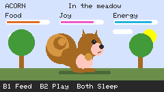
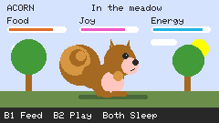
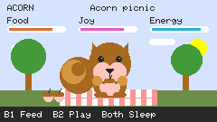
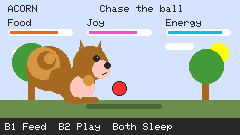
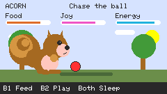
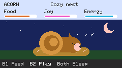
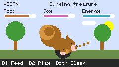
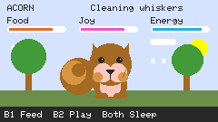

# Acorn — LILYGO T-PicoC3 squirrel pet

Arduino sketch for the RP2040 side of the board, with a 240 × 135 landscape
display. Includes blinking, a curled moving tail, feeding, bouncing play, sleep,
and three slowly changing care meters. State resets when power is removed.
Distinct scenes show a front-facing picnic, running ball chase, nighttime
sleeping nest, burying an acorn, and grooming. Idle views cycle every eight
seconds; feeding and play scenes last five seconds.

## Screenshots and animations

These are pixel-for-pixel **firmware framebuffer renders**, made by executing
`SquirrelPet.ino` with the project's Adafruit GFX rasterizer. Each file is
240 × 135 pixels, with no resizing, smoothing, or added artwork. They are not
photographs or captures from the physical LCD; LCD color and brightness can differ.

| Scene | Screenshot | Animation |
| --- | --- | --- |
| Meadow |  |  |
| Picnic |  |  |
| Play |  |  |
| Sleep |  |  |
| Digging |  |  |
| Grooming |  |  |

### Regenerate the media

Requires `clang++`, Python 3, and Pillow. From the repository directory:

```sh
python3 tools/render_assets.py
```

On the original Mac, Pillow is available in the bundled Python runtime:

```sh
/Users/jeaimehp/.cache/codex-runtimes/codex-primary-runtime/dependencies/python/bin/python3 tools/render_assets.py
```

`tools/host/` supplies inert Arduino/SPI/LCD interfaces for desktop rendering;
the actual scene drawing and font rasterization run unchanged. The script checks
PNG pixels and decoded GIF pixels against the RGB565 framebuffer expanded to RGB.
Each GIF loops over 5.2 seconds. GIF's 10 ms timing resolution requires alternating
60/70 ms frame delays to preserve the sketch's 65 ms average. Consecutive identical
frames may be merged without changing playback.

## Build and upload

1. Install Arduino IDE and the **Raspberry Pi Pico/RP2040** board package by
   Earle F. Philhower. Board-manager URL:
   https://github.com/earlephilhower/arduino-pico/releases/download/global/package_rp2040_index.json
2. Install **Adafruit ST7735 and ST7789 Library**, **Adafruit GFX Library**, and
   **Adafruit BusIO** using Library Manager. These libraries were present on
   this Mac when the sketch was created.
3. Open `SquirrelPet.ino`. Select **Raspberry Pi Pico** and the RP2040 port
   `/dev/cu.usbmodem124301` (USB serial `DE616C825776382A`).
4. Compile and upload. Upload replaces the RP2040's current program.
   If automatic upload fails, hold BOOT, press/release RESET, then release BOOT
   and upload to the resulting RP2040 bootloader drive. Port names may change.

## Controls

- GPIO 6 button: feed an acorn.
- GPIO 7 button: play with a bouncing ball.
- Both buttons: toggle sleep. Either single button wakes the squirrel.

## Hardware

ST7789: SCK 2, MOSI 3, CS 5, DC 1, RESET 0, backlight 4.
Board power enable: GPIO 22. Buttons use internal pull-ups.
Uses a 64,800-byte framebuffer. No additional image assets or network required.

Pin mapping and board setup:
https://github.com/Xinyuan-LilyGO/T-PicoC3

Compiled successfully with Arduino CLI 1.5.1 and Arduino-Pico 6.3.0, then
flashed to RP2040 serial DE616C825776382A on October 9, 2026. The upload
completed and the board returned at `/dev/cu.usbmodem124301`.
The display's physical appearance has not been visually verified.

The existing display library contained duplicate numbered source files.
A project-local copy without those duplicates is used for compilation:

```sh
arduino-cli compile --fqbn rp2040:rp2040:rpipico --library /Users/jeaimehp/Documents/Arduino/SquirrelPet/dependencies/Adafruit_ST7735_and_ST7789_Library --output-dir /Users/jeaimehp/Documents/Arduino/SquirrelPet/build /Users/jeaimehp/Documents/Arduino/SquirrelPet
arduino-cli upload --fqbn rp2040:rp2040:rpipico --port /dev/cu.usbmodem124301 --input-dir /Users/jeaimehp/Documents/Arduino/SquirrelPet/build /Users/jeaimehp/Documents/Arduino/SquirrelPet
```
